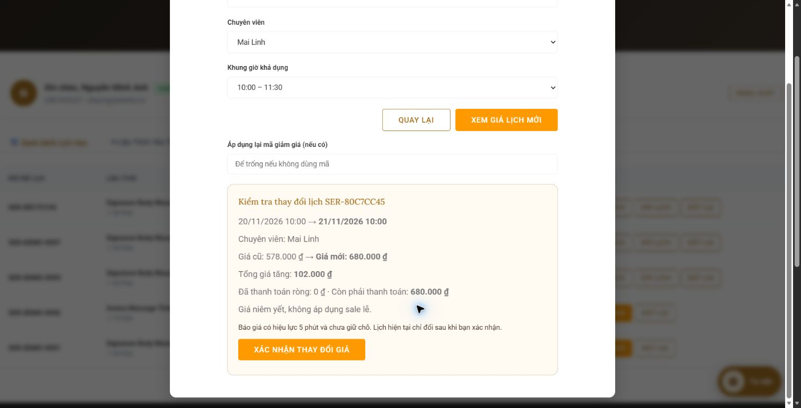
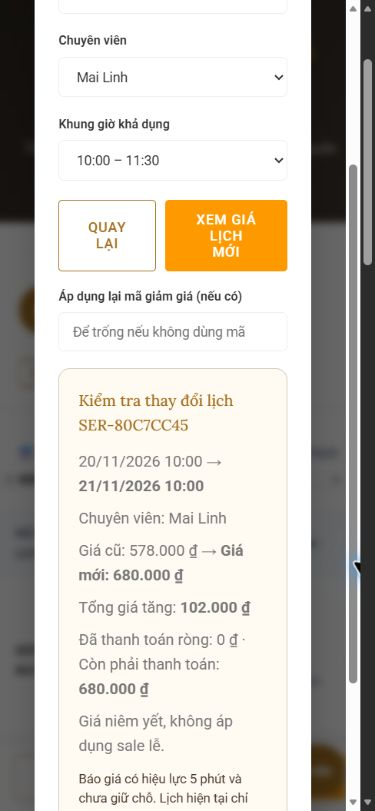

# Báo cáo tích hợp sale lễ, Agent Admin và dời lịch

**Cập nhật 20/10/2026:** Menu động, trang ưu đãi theo mẫu, lịch sử hội thoại và dự phòng Gemini đã được triển khai. 9 tình huống Gemini thật đã kiểm tra thành công qua nhiều đợt; 174/174 kiểm thử tự động đạt. Xem [báo cáo mới nhất](SPA_AGENT_LIVE_TEST_REPORT.md). Nội dung bên dưới giữ kết quả và giới hạn tại thời điểm 19/10; lần kiểm tra 20/10 không khởi động lại server thật.

Ngày kiểm chứng: 19/10/2026. Phạm vi đã triển khai: quản lý sale, định giá xuyên suốt website, công cụ Agent Admin và báo giá/xác nhận dời lịch.

## Chức năng đã nối hoàn chỉnh

- Admin tạo/sửa/bật/tắt sale tại **Quản trị → Khuyến mãi** hoặc bằng công cụ của **Agent Spa**. Biểu mẫu hỗ trợ phần trăm, số tiền cố định, trần giảm và phạm vi toàn menu/danh mục/dịch vụ/thời lượng. Agent hỗ trợ nhiều target cùng loại; biểu mẫu giữ nguyên nhiều target cũ khi chỉ sửa thông tin khác.
- Sale xét ngày sử dụng dịch vụ, gồm cả hai đầu khoảng ngày. Khách đặt trước được hưởng ưu đãi cho lịch đúng ngày lễ. Chọn ngày khác lễ trả giá thường hoặc xét mã do khách chủ động nhập.
- Chỉ chọn một sale theo số tiền giảm thực tế sau trần và làm tròn, rồi độ hẹp phạm vi, thời điểm tạo/cập nhật mới nhất. Không cộng sale với sale hoặc với mã.
- Danh mục, modal dịch vụ, trang chi tiết, bước chọn dịch vụ và tổng tiền đặt lịch hiển thị giá theo ngày sử dụng. Giá gốc trong dữ liệu dịch vụ được giữ riêng. Chat khách hàng cũng lấy giá từ dữ liệu thật, giữ ngày khi tải lại và truyền ngày vào đường dẫn đặt lịch.
- Máy chủ tính lại giá khi tạo lịch; không tin giá gửi từ trình duyệt. Khi tổng đã hiển thị thay đổi, trả `PRICE_CHANGED` để khách xem lại trước khi đặt.
- Mọi đường dời lịch dùng báo giá có hạn 5 phút, gắn với chủ thể tạo báo giá. Hiển thị ngày/giá cũ, ngày/giá mới, chênh lệch và tình trạng tiền đã thu/còn thiếu/cần hoàn. Chỉ nút **Xác nhận thay đổi giá** gửi yêu cầu ghi lịch, kể cả chênh lệch bằng 0.
- Agent chỉ có công cụ chuẩn bị báo giá; không được cung cấp công cụ xác nhận. Endpoint dời lịch trực tiếp cũ trả `428 QUOTE_REQUIRED`.
- Khi xác nhận, máy chủ kiểm tra lại quyền, hạn báo giá, trạng thái lịch, phiên bản dữ liệu, giá và khung giờ. Sale mới được thêm sau khi xem báo giá cũng làm báo giá cũ mất hiệu lực. Không tự thay báo giá rồi xác nhận hộ.
- Chênh lệch tổng tiền được phân biệt với khoản thực sự cần thu/hoàn, có xét lịch sử thanh toán. Xác nhận dời lịch không tạo giao dịch thu hoặc hoàn tiền.
- Thao tác sale có revision, mã yêu cầu chống lặp, nhật ký và đối chiếu dữ liệu vừa ghi. Gửi lại cùng mã yêu cầu không tạo thêm sale. Agent lưu biên nhận bền vững; nếu AI lỗi sau khi đã ghi, giao diện vẫn nhận kết quả máy chủ đã xác minh.

## Cách dùng

Backend chính tại cổng 3001 đã được khởi động lại với bản sửa và cấu hình `.env` hiện có. Tải lại trang và đăng nhập lại để dùng tính năng mới; phiên đăng nhập của ứng dụng hiện nằm trong bộ nhớ nên hết hiệu lực khi tiến trình khởi động lại. Lệnh khởi chạy bình thường vẫn là `npm start`. Migration bổ sung bảng khi backend khởi tạo; không cần xóa hay tạo lại SQLite.

Ví dụ lệnh đủ rõ tại **Agent Spa**:

> Tạo sale giảm 15% cho toàn bộ dịch vụ, áp dụng cho ngày sử dụng từ 20/11/2026 đến hết 20/11/2026, tên Sale 20/11.

> Sửa Sale 20/11 thành giảm 20%, giữ nguyên ngày và phạm vi.

> Tắt Sale 20/11.

Lệnh thiếu mức giảm/ngày có năm/phạm vi hoặc trùng tên cần được hỏi lại. Không tự suy đoán ngày lễ âm lịch. Hiệu quả hiểu lệnh thực tế của provider vẫn cần kiểm chứng thêm theo giới hạn bên dưới.

Khi khách/admin dời lịch: chọn lịch mới → **Xem giá mới** → xem chênh lệch → **Xác nhận thay đổi giá**. Nếu báo giá hết hạn hoặc dữ liệu đổi, lấy báo giá mới và bấm xác nhận lại.

## Giao diện HTTP

| Endpoint | Hợp đồng chính |
| --- | --- |
| `GET /api/bootstrap` | Thêm `holidaySales` và `versions.holidaySales`; không tạo collection sale thứ hai. |
| `GET /api/services?serviceDate=YYYY-MM-DD` | Giá hiển thị và bộ lọc giá theo ngày đã chọn; giữ `price` gốc. |
| `POST /api/pricing/quote` | `{serviceId,duration,serviceDate,promoCode?}` → giá do máy chủ tính, không ghi lịch. |
| `GET /api/admin/holiday-sales` | Danh sách sale cho admin. |
| `POST /api/admin/holiday-sales` | `{sale,requestId}` → chiến dịch đã đối chiếu sau ghi; 201 hoặc 200 khi gửi lại. |
| `PATCH /api/admin/holiday-sales/:id` | `{patch,expectedRevision,requestId}`; từ chối sửa dựa trên revision cũ. |
| `POST /api/bookings/:id/reschedule/quote` | `{date,startTime,staffId?,promoCode?,phone?}` → `{quote,requiresConfirmation:true}`. |
| `POST /api/bookings/:id/reschedule/confirm` | `{quoteId,phone?}`; ID gắn với người tạo, gửi lại xác nhận thành công không ghi lần hai. |

`phone` chỉ dành cho lịch khách vãng lai cũ chưa có tài khoản; báo giá trả về không chứa số điện thoại. Customer chỉ dời lịch thuộc tài khoản của mình; staff không có quyền này. Các endpoint ghi kiểm tra nguồn yêu cầu và phiên/vai trò tại máy chủ.

## Kiểm chứng

`npm test`: **149/149 đạt**, exit code 0, không bỏ qua bài nào:

- 62 bài nghiệp vụ hiện có.
- 87 bài Node test, gồm định giá, SQLite, HTTP, agent với provider giả và hành vi nút xác nhận.
- 18 bài tích hợp sale kiểm tra phân quyền, chống lặp, revision, bootstrap/catalog, giá chat theo ngày và tải lại, sale ưu tiên mã, giá giả, quote không ghi, xác nhận lặp, dời giữa các dịp lễ, khóa đường cũ, quyền sở hữu, báo giá lỗi thời, thay đổi thanh toán/khung giờ, hết hạn, mã không bị tính lượt hai lần và biên nhận sau lỗi AI.
- 3 bài riêng cho adapter Gemini kiểm tra giữ nguyên các phần chứa chữ ký qua nhiều vòng gọi, ID phản hồi tương ứng, không đưa phần `thought` vào câu trả lời/lịch sử khách nhận, loại metadata không đáng tin trong history, giới hạn lời gọi trước mọi thao tác ghi.

Kiểm tra trên Edge bằng SQLite tạm, tách cookie qua host `127.0.0.1`:

1. Admin dùng biểu mẫu thật tạo sale 15% toàn menu cho ngày 20/11/2026.
2. Danh mục ngày 20/11 hiển thị Signature Body Massage 90 phút **680.000đ → 578.000đ**; ngày 21/11 hiển thị 680.000đ.
3. Khách tạo lịch ngày 21/11 giá 680.000đ. Chuẩn bị dời sang 20/11 cho báo giá 578.000đ, giảm 102.000đ; lịch cũ được giữ trước khi bấm xác nhận.
4. Bấm xác nhận thực sự lưu lịch ngày 20/11 với giá 578.000đ. Chuẩn bị dời ngược lại hiển thị tăng 102.000đ; chưa xác nhận lần thứ hai.
5. Kiểm tra bố cục desktop và viewport điện thoại; không ghi nhận lỗi console. Popup đã được sửa trạng thái accessibility để nội dung đang mở không còn bị `aria-hidden=true`.

Các bài tự động và dữ liệu trình duyệt dùng bộ nhớ hoặc SQLite tạm. Không thêm sale hoặc lịch kiểm thử vào database nghiệp vụ đang dùng, không phát sinh thanh toán thực.

Kiểm tra backend chính sau khi nạp bản sửa:

- Đã xác minh tiến trình Node của dự án đang giữ cổng 3001 trước khi dừng và chạy lại cùng lệnh/cấu hình.
- Đã tạo backup nhất quán bằng SQLite `VACUUM INTO`: `server/data/backups/serenity-before-holiday-integration-2026-10-19T03-15-52-706Z.sqlite`.
- Hash toàn bộ 85 bản ghi `collection_records` theo thứ tự ổn định giống nhau trước/sau; số dịch vụ vẫn 32, số chuyên viên vẫn 8.
- `holiday_pricing_schema_version=1`; bootstrap có `holidaySales`, số sale bằng 0. Không tạo ưu đãi thật khi kiểm thử.
- `POST /api/pricing/quote` thực tế cho Signature 90 phút ngày 20/11/2026 trả giá niêm yết 680.000đ, đúng khi database chính chưa có sale.

## Gemini: đã sửa và giới hạn kiểm chứng

Lượt gọi thật ban đầu đã gọi được công cụ đọc, sau đó lỗi ở vòng nhận kết quả. Adapter trước đây dựng lại `functionCall` và làm mất chữ ký/ID provider. Bản sửa giữ nguyên các model parts trong vòng trao đổi nội bộ và trả ID gốc nếu provider cấp; không lưu metadata đó vào lịch sử trả cho trình duyệt. Đây là yêu cầu trong [tài liệu chữ ký Gemini](https://ai.google.dev/gemini-api/docs/generate-content/thought-signatures) và [hợp đồng FunctionCall/FunctionResponse](https://ai.google.dev/api/generate-content#FunctionCall).

Sau sửa, kiểm thử mô phỏng đạt. Các lượt kiểm chứng thật chỉ đọc tiếp theo hết thời gian chờ 15–30 giây; yêu cầu tối thiểu chỉ yêu cầu trả `OK` cũng hết thời gian chờ 30 giây. Vì vậy **chưa xác nhận được vòng gọi công cụ Gemini thật hoàn tất sau sửa**, chưa chứng minh khả năng hiểu lệnh và ghi sale bằng AI thật. Không suy diễn đây là lỗi khóa hoặc hết quota khi không nhận được phản hồi tương ứng.

Thời gian chờ agent được tách khỏi chatbot: `AI_AGENT_REQUEST_TIMEOUT` mặc định 30.000 ms, tối đa 45.000 ms; `AI_AGENT_TIMEOUT` mặc định 60.000 ms, tối đa 90.000 ms. Client chờ tối đa 100.000 ms. Có thể cấu hình qua `.env`; không đổi khóa/model đang dùng. Biểu mẫu quản trị, tính giá và xác nhận dời lịch không phụ thuộc AI.

## Phần còn lại của kế hoạch ban đầu

- Chưa triển khai menu động và tạo trang nội dung ưu đãi theo mẫu. Đây là phần CMS riêng trong kế hoạch ban đầu.
- Chưa thử ghi bằng provider AI thật và chưa triển khai lên máy chủ bên ngoài. Backend local chính đã được nạp bản sửa và kiểm tra API chỉ đọc.
- Chưa tự động thu/hoàn tiền; giao diện chỉ báo nghĩa vụ thanh toán sau khi đổi lịch.
